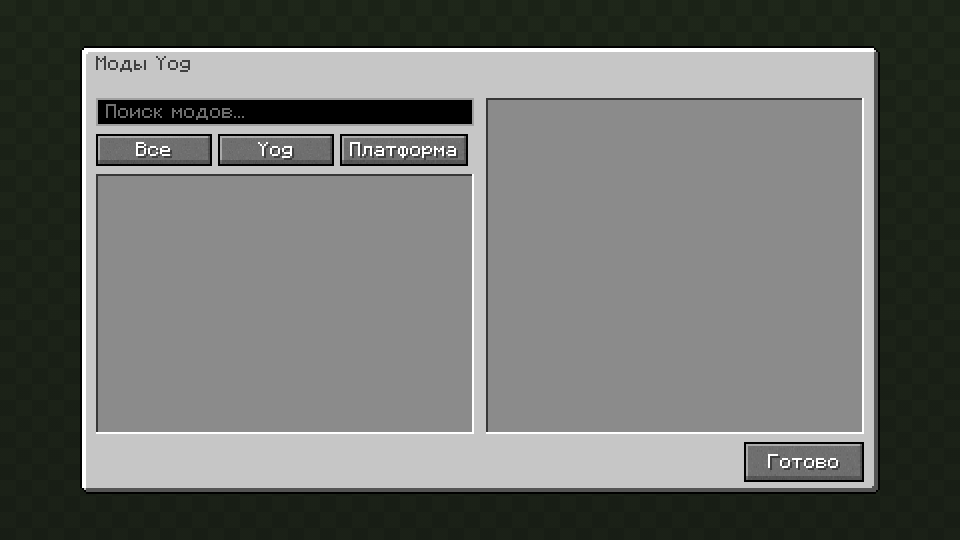

<div align="center">

<a id="top"></a>

# 📋 Yog Mod List

### Список модов прямо в игре для загрузчика Yog

[](LICENSE)
[](yog.toml)
[](https://crates.io/crates/yog-kit)
[](https://github.com/F000NKKK/Yog-Mod-Loader)
[](https://github.com/F000NKKK/Yog-Mod-Loader)

🇺🇸 [English](README.md) | 🇷🇺 **Русский**

[Обзор](#-обзор) • [Возможности](#-возможности) • [Как устроен](#-как-устроен) • [Сборка](#-сборка) • [Лицензия](#-лицензия)

</div>

---

## 📖 Обзор

**Yog Mod List** добавляет в игру кнопку **«Моды Yog»**: на титульный экран
в Fabric и на экран списка модов в Forge и NeoForge. Она открывает список
всех установленных модов: модов `.yog` и, если загрузчик их отдаёт, обычных
Java-модов платформы.

Это чистый мод на [Yog](https://github.com/F000NKKK/Yog-Mod-Loader): Rust и
разметка `.yui`, ни строчки своего Java-кода. Заодно это эталонный пример
экрана с моделью представления на `yog-kit`.

<p align="center"></p>

## ✨ Возможности

- 🔎 **Поиск** по названию, id или описанию прямо при вводе
- 🏷️ **Фильтры**: все, Yog, платформа (фильтр, которому нечего показать, неактивен)
- 📜 **Список**: сначала моды Yog, затем по алфавиту; колесо мыши, полоса прокрутки и клавиатура
- 📝 **Панель подробностей**: название, версия, источник, авторы, id и полное описание
- 🌍 **Английский и русский** интерфейс, который следует языку игры

## 🧩 Как устроен

| Файл | Что это |
|---|---|
| [`src/lib.rs`](src/lib.rs) | Регистрирует экран и кнопку в меню (`register_menu_entry`) |
| [`src/mod_list.yui`](src/mod_list.yui) | Разметка экрана: `Grid` с заголовком, поиском, фильтрами, `ListView` и панелью подробностей |
| [`src/mod_list.rs`](src/mod_list.rs) | `ModListVm`, модель представления: при открытии загружает `installed_mods()`, фильтрует, ищет, хранит выбор; там же тест на `TestHost` без игры |
| [`resources/Strings.yres`](resources/Strings.yres), [`Strings.ru_ru.yres`](resources/Strings.ru_ru.yres) | Тексты на английском и русском; название и описание мода в `yog.toml` тоже берутся отсюда (`@Strings.mod_name`) |
| [`resources/Colors.yres`](resources/Colors.yres) | Цвета источника в панели подробностей (`Colors::SOURCE_YOG`, `Colors::SOURCE_PLATFORM`) |

Привязки в разметке напрямую вызывают модель представления:

```xml
<TextBox text="{x:Bind search, Mode=TwoWay}" placeholder="@Strings.search.placeholder" />
<ToggleButton text="@Strings.filter.yog"
              checked="{x:Bind filter == Filter::Yog}"
              enabled="{x:Bind has(Filter::Yog)}"
              command="{x:Bind set_filter(Filter::Yog)}" />
<ListView items="{x:Bind visible()}" selected="{x:Bind selected_id(), BindBack=select}" />
```

Все файлы открываются в [Yog-IDLE](https://github.com/F000NKKK/Yog-IDLE):
экран и компоненты в дизайнере, `.yres` в таблице ресурсов. Форматы описаны
в документации Yog-IDLE:
[`.yui`](https://github.com/F000NKKK/Yog-IDLE/blob/master/docs/yui.md),
[модели представления](https://github.com/F000NKKK/Yog-IDLE/blob/master/docs/mvvm.md),
[`.yres`](https://github.com/F000NKKK/Yog-IDLE/blob/master/docs/yres.md).

## 🔨 Сборка

Нужен CLI `yog` (`cargo install yog-cli`).

```bash
yog build              # -> artifacts/yog-modlist.yog
```

Положите `.yog` в `<папка игры>/yog-mods/` рядом с jar загрузчика Yog.

Чтобы запустить в dev-окружении, склонируйте
[Yog-Mod-Loader](https://github.com/F000NKKK/Yog-Mod-Loader) рядом с этим
репозиторием и выберите конфигурацию запуска из `yog.toml`:

```bash
yog run fabric 1.21.1  # все загрузчики и версии: yog run --list
```

Тест модели представления работает без игры: после сборки выполните
`cargo test` в `.yog-build/`.

## 📄 Лицензия

**AGPL-3.0-only**, см. [LICENSE](LICENSE).

---

<div align="center">

**[⬆ Наверх](#top)**

Часть проекта [Yog](https://github.com/F000NKKK/Yog-Mod-Loader)

</div>
